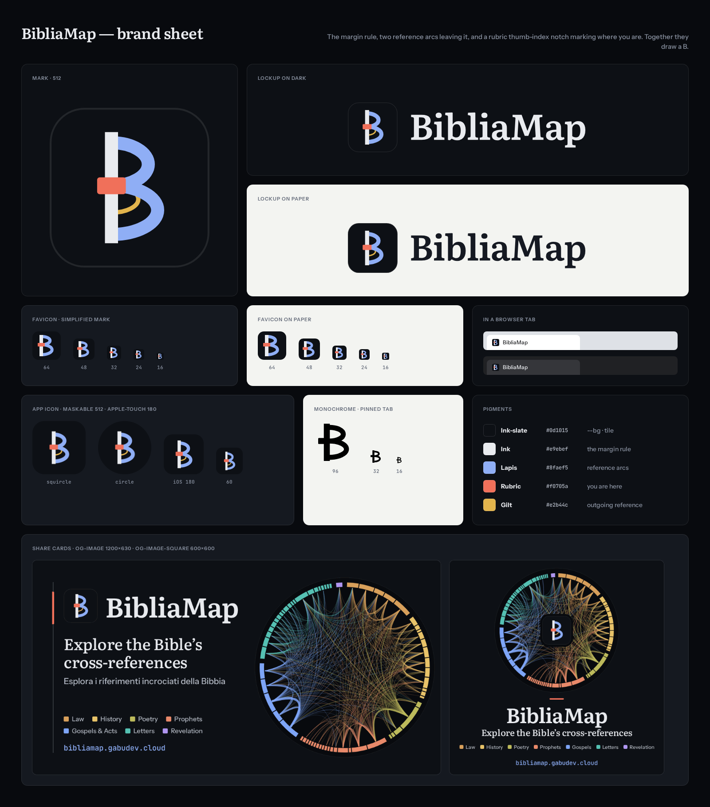

# BibliaMap brand

## The mark

BibliaMap is the study Bible's reference column made navigable (see `../design-spec.md` §2). The
mark is that column, reduced to four strokes:

- **The margin rule** (ink) — the thin vertical rule every verse hangs from.
- **Two reference arcs** (lapis) leaving the rule and returning to it — a cross-reference drawn the
  way the app draws it. Lapis is the pigment for "anything you can act on".
- **The rubric notch** — the thumb-index notch from the shell's navigation, sitting where the arcs
  meet the rule: *you are here*, the verse being studied.
- **One nested gilt arc** (full mark only) — an outgoing reference, the app's `--outgoing` colour.

Rule + arcs draw a **B**. Dark-first: the tile is `--bg` dark (`#0d1015`), the same desk at night.

| Pigment | Hex (dark theme token) | Job in the mark |
| --- | --- | --- |
| Ink-slate | `#0d1015` (`--bg`) | Tile |
| Ink | `#e9ebef` (`--ink`) | Margin rule |
| Lapis | `#8faef5` (`--accent`) | Reference arcs |
| Rubric | `#f0705a` (`--rubric`) | Notch |
| Gilt | `#e2b44c` (`--gilt`) | Nested arc (≥ 64px only) |

## Files

Hand-authored sources (edit these):

| File | Use |
| --- | --- |
| `frontend/public/bibliamap-icon.svg` | Full mark. Shell brand, manifest `any`, source for the PNGs. Has `<g id="tile">` and `<g id="glyph">` — the build script relies on those ids. |
| `frontend/public/favicon.svg` | Simplified mark for 16–48px (no gilt arc, heavier strokes, 32-unit grid so it is pixel-aligned at 16px). The tile lifts to `#1c212a` under `prefers-color-scheme: dark` so it stays visible on dark browser chrome. |
| `frontend/public/safari-pinned-tab.svg` | Monochrome silhouette (`mask-icon`). |

Generated (do not edit; run `scripts/brand/`):

| File | Size | Use |
| --- | --- | --- |
| `frontend/public/favicon.ico` | 16/32/48 | Legacy favicon |
| `frontend/public/apple-touch-icon.png` | 180 | iOS home screen (full bleed, iOS rounds it) |
| `frontend/public/bibliamap-icon-192.png`, `-512.png` | 192, 512 | Manifest, purpose `any` |
| `frontend/public/bibliamap-icon-maskable-512.png` | 512 | Manifest, purpose `maskable` (glyph at 88%, inside the safe circle) |
| `frontend/public/og-image.png`, `og-image-square.png` | 1200×630, 600×600 | Share cards (`scripts/og-image/`) |
| `docs/design/brand/bibliamap-lockup-{dark,light}.svg` | 618×128 | Mark + wordmark, wordmark outlined |
| `docs/design/brand/brand-sheet.png` | | This overview |

## Wordmark and lockup

"BibliaMap", one word, capital B and M. Literata 600, tracking −0.018em, in `--ink`. In the lockup
the cap height is centred on the tile and the gap is about a quarter of the tile. In the app the
shell sets the name as live text (`.brand-title`) next to `bibliamap-icon.svg`.

## Rules

- Do not recolour the strokes; each pigment has one job. The tile stays dark on both themes.
- Under 64px use `favicon.svg`, not the full mark.
- Clear space: a quarter of the tile on every side.
- When a share image changes, bump `?v=` on the image URLs in `frontend/index.html`.
